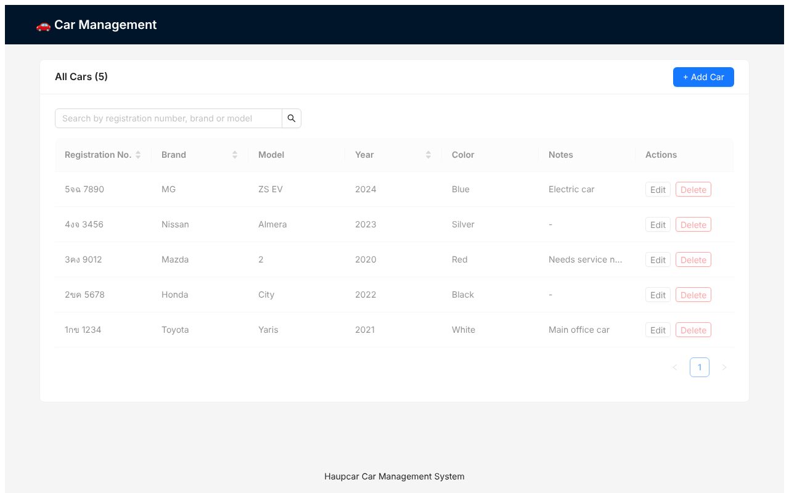
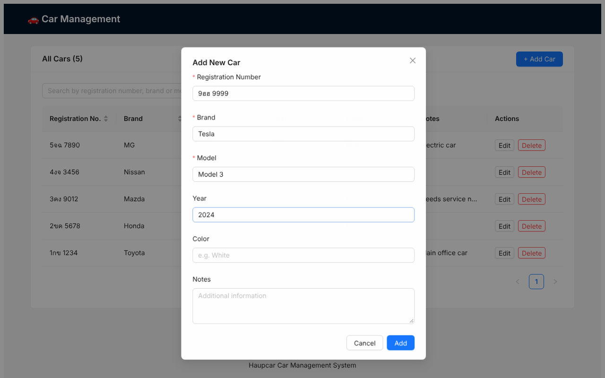

# Car Management System

A web application for recording and managing company car information



---

## Features

### Required features
- **Add** a new car (registration number, brand, model, year, color, notes)
- **View** all cars in a table
- **Edit** car information
- **Delete** a car (with confirmation before deleting)



---

## Project Structure

```
car-management/
├── backend/
│   └── src/
│       ├── index.js                  # Express app, middleware, start server
│       ├── db.js                     # SQLite connection + create table
│       ├── seed.js                   # Sample data
│       ├── routes/cars.js            # URL → controller mapping
│       └── controllers/carController.js  # CRUD logic and validation
└── frontend/
    └── src/
        ├── main.jsx                  # Entry point
        ├── App.jsx                   # Page layout (header, content, footer)
        ├── api/carApi.js             # All API calls in one place
        ├── pages/CarListPage.jsx     # Car table, search, add/edit/delete actions
        └── components/CarFormModal.jsx  # Form used for both add and edit
```

---

## Getting Started

### Requirements
- [Node.js](https://nodejs.org/) version 20 or newer
- npm (comes with Node.js)

### 1. Clone the project
```bash
git clone <your-repository-url>
cd car-management
```

### 2. Start the backend (API)
```bash
cd backend
npm install
npm run seed
npm run dev
```
The API runs at **http://localhost:3001**. Check it with http://localhost:3001/api/health

### 3. Start the frontend
```bash
cd frontend
npm install
npm run dev
```
Open **http://localhost:5173** in your browser.

---

## Database

Table `cars`

| Column | Type | Note |
|---|---|---|
| id | INTEGER | Primary key, auto increment |
| registration_number | TEXT | Required, unique |
| brand | TEXT | Required |
| model | TEXT | Required |
| year | INTEGER | Optional |
| color | TEXT | Optional |
| notes | TEXT | Optional |
| created_at | TEXT | Set when created |
| updated_at | TEXT | Updated on every edit |

---
